<p align="center">
  <picture>
    <source media="(prefers-color-scheme: dark)" srcset="https://raw.githubusercontent.com/junkerderprovinz/bombvault-widget/main/.github/assets/bombvault-widget-banner-dark.png">
    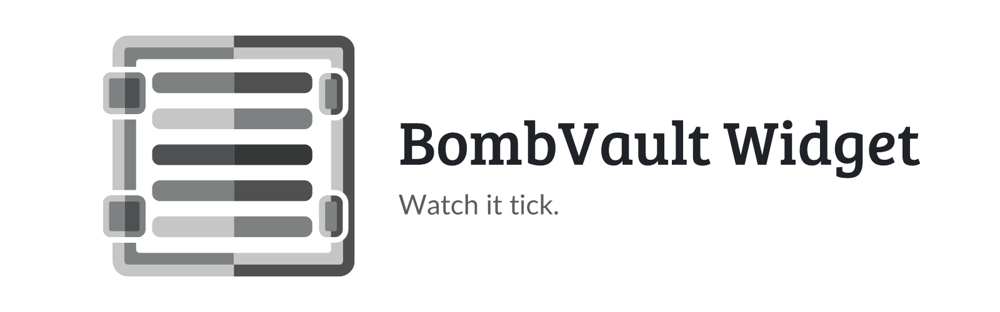
  </picture>
</p>

<p align="center">
  <a href="https://github.com/junkerderprovinz/bombvault-widget/actions/workflows/release.yml"></a>&nbsp;
  <a href="https://unraid.net"></a>&nbsp;
  <a href="https://github.com/junkerderprovinz/bombvault"></a>&nbsp;
  <a href="LICENSE"></a>
</p>

<br>

<p align="center">
💣 <b>BombVault Widget</b> puts <a href="https://github.com/junkerderprovinz/bombvault">BombVault</a>'s activity log where you already look: a <b>real, native tile</b> on the Unraid&nbsp;7 <b>dashboard</b>. Every backup, restore, verify, prune, off-site replication and drill scrolls by as it happens, plus the <b>next scheduled run</b>, in the same dark terminal-style log as BombVault's own widget.<br>
<br>
<b>Read-only</b>: the tile is fed through a same-origin proxy; the widget token never reaches the browser.
</p>

<br>

<p><a id="table-of-contents" href="#table-of-contents"><picture><source media="(prefers-color-scheme: dark)" srcset=".github/assets/sections/table-of-contents-dark.svg"></picture></a></p>

1. [Support](#1-support)
2. [What is this?](#2-what-is-this)
3. [Screenshots](#3-screenshots)
4. [Requirements](#4-requirements)
5. [Install on Unraid](#5-install-on-unraid)
6. [Setup](#6-setup)
7. [How it works](#7-how-it-works)
8. [Security](#8-security)
9. [License](#9-license)
10. [How AI is used here](#10-how-ai-is-used-here)

<br>

<p><a id="1-support" href="#1-support"><picture><source media="(prefers-color-scheme: dark)" srcset=".github/assets/sections/1-support-dark.svg">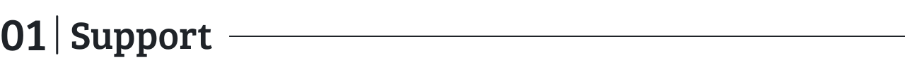</picture></a></p>

<p align="center">
A one-knight job: I build it, keep it running, work through the issues and add what people ask for, until nothing is missing. It is free, with no accounts, no telemetry, no ads and no paid tier. No asterisk anywhere. Nothing readable ever leaves your own walls. Forged on evenings and weekends, with heart and stubbornness.
</p>

<p align="center">
If it has earned a place on your server or computer, toss a coin to your knight: it helps cover the costs and keeps the project alive. It also makes this knight's heart beat a little faster. Three ways below, whichever suits you.
</p>

<br>

<p align="center">
  <a href="https://buymeacoffee.com/junkerderprovinz"></a>
  &nbsp;
  <a href="https://www.paypal.com/donate/?hosted_button_id=76FVV52TKXTUS"></a>
  &nbsp;
  <a href="https://junkerderprovinz.github.io/junkerderprovinz/"></a>
</p>

<br>

<p><a id="2-what-is-this" href="#2-what-is-this"><picture><source media="(prefers-color-scheme: dark)" srcset=".github/assets/sections/2-what-is-this-dark.svg">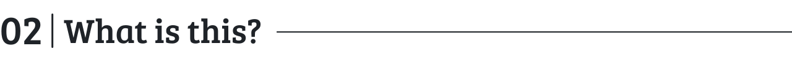</picture></a></p>

A small Unraid plugin (no daemon, no container) that registers a native dashboard tile named **BombVault Activity**. The tile shows up in the dashboard's tile-management list like the built-in ones: hide it, move it between columns, collapse it. Its body is a fixed-height, scrollable, always-dark log (newest at the bottom, auto-follow unless you scroll up) whose lines mirror BombVault's own embeddable widget one-to-one: green for success, red for failures, blue for off-site replication, yellow for the pulsing "next: …" line.

<p><a id="3-screenshots" href="#3-screenshots"><picture><source media="(prefers-color-scheme: dark)" srcset=".github/assets/sections/3-screenshots-dark.svg">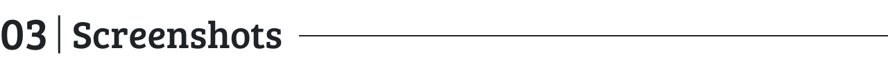</picture></a></p>

<p align="center">
  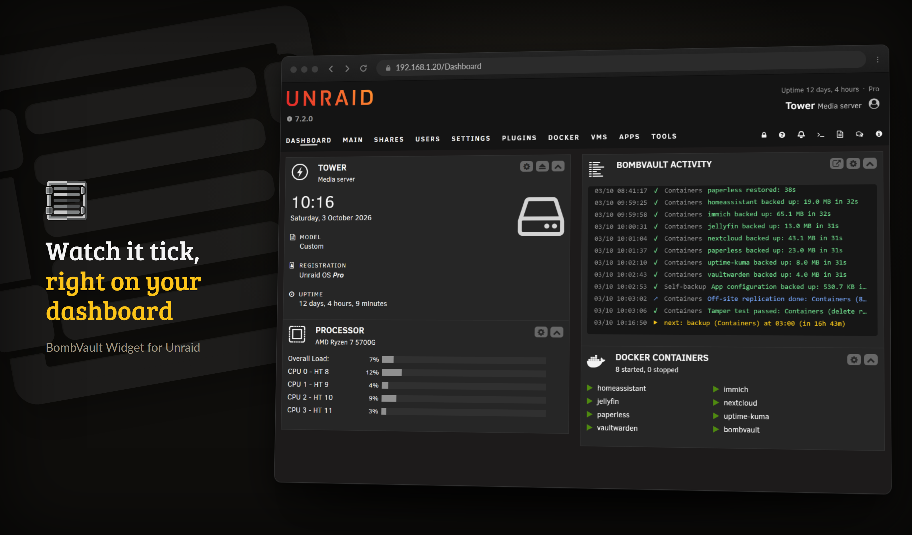
  <br><em>The BombVault Activity tile on the Unraid dashboard: every backup, restore and verify scrolls by in the dark terminal-style log, with the pulsing "next: …" line at the bottom.</em>
</p>

<br>

<p align="center">
  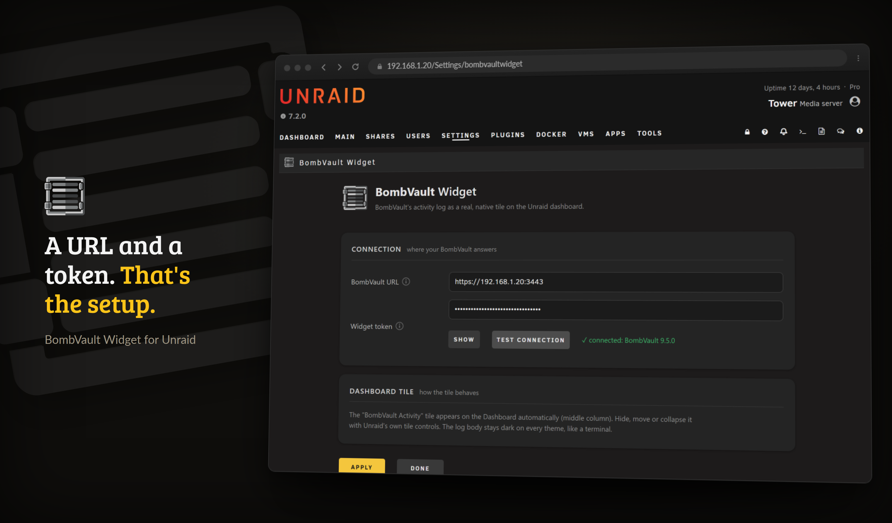
  <br><em>Settings under Utilities: the BombVault URL and the widget token, a one-click connection test, and a short note on how the tile behaves.</em>
</p>

<p><a id="4-requirements" href="#4-requirements"><picture><source media="(prefers-color-scheme: dark)" srcset=".github/assets/sections/4-requirements-dark.svg">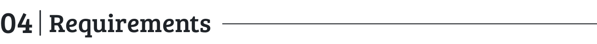</picture></a></p>

- **Unraid 6.12.0 or newer** (the tile uses the modern dashboard; built for Unraid 7).
- **[BombVault](https://github.com/junkerderprovinz/bombvault) 6.9.0 or newer** running on your network.
- A **widget token**, generated in BombVault → Settings → System → Dashboard widget.

<p><a id="5-install-on-unraid" href="#5-install-on-unraid"><picture><source media="(prefers-color-scheme: dark)" srcset=".github/assets/sections/5-install-on-unraid-dark.svg">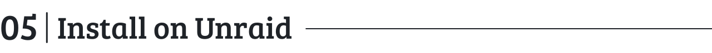</picture></a></p>

*Community Applications listing: TODO. Until the CA entry in [unraid-apps](https://github.com/junkerderprovinz/unraid-apps) is live, install via* **Plugins → Install Plugin** *with the raw `.plg` URL:*

```
https://raw.githubusercontent.com/junkerderprovinz/bombvault-widget/main/plugin/bombvaultwidget.plg
```

<p><a id="6-setup" href="#6-setup"><picture><source media="(prefers-color-scheme: dark)" srcset=".github/assets/sections/6-setup-dark.svg">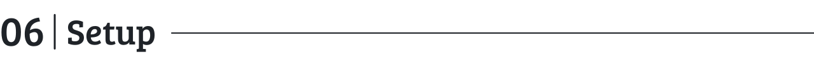</picture></a></p>

1. In **BombVault** open *Settings → System → Dashboard widget* and generate a widget token (copy it right away, it is shown only once).
2. In **Unraid** open *Settings → Utilities → BombVault Widget*, enter the BombVault URL (e.g. `https://192.168.20.51:3443`) and the token, hit **Apply**. Pasting BombVault's full widget URL (`…/widget?token=…`) into the token field works too, the token part is extracted automatically.
3. Click **Test connection**. It answers with the BombVault version when everything is wired.
4. Open the **Dashboard**: the *BombVault Activity* tile is live in the middle column.

<p><a id="7-how-it-works" href="#7-how-it-works"><picture><source media="(prefers-color-scheme: dark)" srcset=".github/assets/sections/7-how-it-works-dark.svg">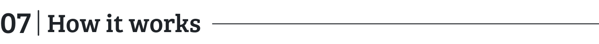</picture></a></p>

- `bombvaultwidget.Dashboard.page` registers the tile (`Menu="Dashboard:0"` + `$mytiles`), a static scaffold with the native Unraid 7 tile header (chevron, an open-BombVault link once a URL is configured, cog to the settings page).
- `scripts/bombvaultwidget.js` polls `server/status.php` every 10 seconds and renders the log rows via `textContent` (no HTML from feed data ever runs).
- `server/status.php` is a same-origin proxy: it reads the URL + token from `/boot/config/plugins/bombvaultwidget/bombvaultwidget.cfg` and calls exactly one endpoint, BombVault's `GET /api/widget/data`, with the `X-Widget-Token` header, 5 s timeout, self-signed LAN TLS accepted. Unreachable or misconfigured = a clean JSON 503, which the tile shows as a pulsing red status line while keeping the history on screen.

<p><a id="8-security" href="#8-security"><picture><source media="(prefers-color-scheme: dark)" srcset=".github/assets/sections/8-security-dark.svg">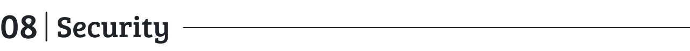</picture></a></p>

The widget token stays server-side: the browser only ever talks to the Unraid webgui (session-protected), and the proxy only ever talks to the one hard-coded BombVault endpoint, so no request parameter can redirect it. On BombVault's side the token grants read-only access to the activity log and schedule preview, nothing else, and can be revoked/rotated any time in BombVault's settings. TLS peer verification is disabled for the LAN call because BombVault serves a self-signed certificate on a private address.

<p><a id="9-license" href="#9-license"><picture><source media="(prefers-color-scheme: dark)" srcset=".github/assets/sections/9-license-dark.svg">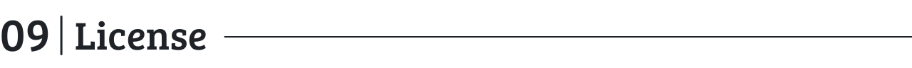</picture></a></p>

AGPL-3.0. See [LICENSE](LICENSE).

<p><a id="10-how-ai-is-used-here" href="#10-how-ai-is-used-here"><picture><source media="(prefers-color-scheme: dark)" srcset=".github/assets/sections/10-how-ai-is-used-here-dark.svg">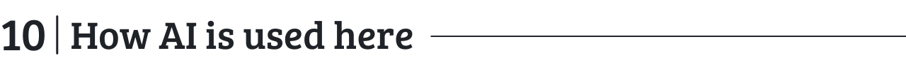</picture></a></p>

One knight builds this, and AI is one of the tools I work with, the same way I work with an editor or a compiler. It helps me write code and documentation and it checks my work, and that saves me a good many evenings. It does not make the decisions, though. I read and understand everything before it ships, and if something here breaks, that is on me and not on the tool.

You do not have to take my word for it. The code is open and every release note is written by hand. The issue tracker shows how problems actually get handled, including the ones I got wrong the first time. If you find something that is not right, open an issue and I will look at it.

<br>

Questions? Check the [BombVault support thread](https://forums.unraid.net/topic/199509-support-junkerderprovinz-bombvault/). Bugs, ideas or feature requests? Please [open a GitHub issue](https://github.com/junkerderprovinz/bombvault-widget/issues).
